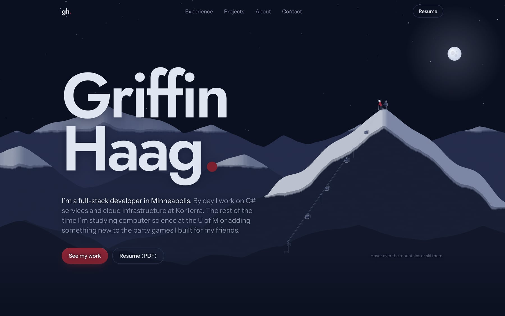

# griffinh.me

The source for my personal site and portfolio. **See it live at [griffinh.me](https://griffinh.me).**

## What's on it

- **A mountain range you can play with.** The homepage hero is drawn on a canvas. Hover the sky to make it snow, push the snow around on the peaks, and drag the skier down the slopes. His tracks fade behind him, and when he reaches the bottom he skates over to the gondola and rides it back to the summit.
- **Projects you can use right on the page.** There are small playable versions of the three [GriffinGames](https://griffinhgames.xyz) games (a trivia round against a bot, a deck of Truth or Griddy cards, and Kings Dice), plus a working copy of DayONE's video library with its filters, search, and admin tools.
- **Project pages** for GriffinGames and DayONE that cover how they work, what was tricky, and how they were tested and deployed.
- **The usual portfolio sections.** Experience, a toolbox that shows where I've used each tool, a bit about me, and a contact form.
- **A hidden terminal** with a few easter eggs. Press `` ` `` anywhere on the site and type `help`.

## How it's built

- **[Astro](https://astro.build) with [Tailwind CSS](https://tailwindcss.com), written in TypeScript.** There's no UI framework. Each interactive piece is a small script, and the site builds to plain static files.
- **The mountain scene** is one canvas and no libraries. The ridgelines are generated, the snow is simulated in columns so it can pile up and be pushed around, and the skier runs on a small state machine (ready, skiing, stopping, skating to the lift, riding, unloading). It works with a mouse, touch, or the arrow keys, and it respects reduced motion.
- **The game previews** recreate each game's core loop in the browser, using a sample of the real trivia questions and cards. The DayONE demo uses the real video list, and adding a video looks up its real YouTube title.
- **The contact form** sends through [Web3Forms](https://web3forms.com), and if a message can't be sent it points people to my email instead.
- **Images** are converted to WebP and served at several sizes, so each device downloads only what its screen needs.
- **Hosted on [Netlify](https://www.netlify.com)**, deployed from `main`. Changes go to a testing branch first and are checked across phones, tablets, and desktops before they're merged.

The layouts are built for every screen size, from a folded phone to a 1440p monitor, with touch targets sized for fingers and a reduced-motion version of every animation.
